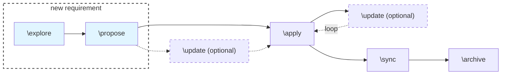

# Overview

This repo is a worked example of [OpenSpec](https://openspec.dev/docs/installation) and
Spec-Driven Development (SDD): write and refine a spec first, then let it drive planning, task
breakdown, and implementation.

Read top to bottom — each step below corresponds to one branch, so you can follow the git history
alongside the writeup. Every step includes the raw slash-command prompt used.

TLDR;



## Prerequisites (branch name 00-openspec-initialize)

### 1. Install Node.js

OpenSpec requires Node.js 20.19.0 or higher.

```bash
node --version
```

### 2. Install the OpenSpec CLI

Docs: [Fission-AI/OpenSpec](https://github.com/Fission-AI/OpenSpec)

```bash
npm install -g @fission-ai/openspec@latest
openspec --version
```

### 3. Initialize OpenSpec in this repo

reference link [initialize-your-project](https://openspec.dev/docs/setup#initialize-your-project)

```bash
openspec init
```

Select Claude Code when prompted. Generates:

- `openspec/` — specs, changes, and project conventions
- `.claude/` — OpenSpec slash commands for Claude

## Steps

> Commands below can be run in VS Code chat (Claude Code, Copilot, etc.).

### 1. Explore the idea (`/opsx:explore`, branch 01-openspec-explore-and-propose)

Thinking-partner mode: an in-memory step that helps clarify requirements. It does not generate any
artifacts; it only feeds the propose stage that follows.

```
/opsx:explore We need a system that accepts bulk hardware orders from enterprise clients, calculates their final net totals using pre-negotiated contract discounts, and tracks each order through its lifecycle from intake to final delivery. Clients should be able to view their order history or cancel active requests.
```

Then `/opsx:propose` was run with no message, under this same first step, so it built the change from
the explore conversation:

```
/opsx:propose
```

`/opsx:propose` creates the change under `openspec/changes/bulk-hardware-orders/` with four main
artifacts: a **proposal** (why and what changes), **specs** (requirements for order intake,
lifecycle, history and cancel, and role selection), a **design** (technical approach and
decisions), and **tasks** (the implementation checklist).

> **Note:** No tech stack was mentioned in the prompt above, so the AI agent assumed one on its own
> when generating these artifacts. This will be changed in upcoming steps.

> **Note:** OpenSpec has no equivalent of Spec Kit's constitution command. Project conventions and
> guardrails live in `CLAUDE.md` and in the `spec.md` files instead.

### 2. Update the change with the Figma design (`/opsx:update`, branch 02-openspec-update-requirement)

Revises the existing planning artifacts (proposal, specs, design, tasks) and keeps them coherent with
one another. It never edits code. Here it folds the UI/UX from the exported Figma HTML in
`figma-designs/` into the `bulk-hardware-orders` change, so the implementation matches the design.

```
/opsx:update analyse the Figma design html figma-designs and add the information about the UI/UX to be same as html when it is implemented
```

> **Note:** The spec is not frozen after `/opsx:propose`. `/opsx:update` can be run at any point to
> modify the change's artifacts (proposal, specs, design, tasks), before or during implementation,
> whenever requirements shift or new decisions need to be folded in.
