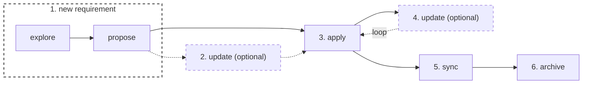

# Overview

This repo is a worked example of [OpenSpec](https://openspec.dev/docs/installation) and
Spec-Driven Development (SDD): write and refine a spec first, then let it drive planning, task
breakdown, and implementation.

Read top to bottom — each step below corresponds to one branch, so you can follow the git history
alongside the writeup. Every step includes the raw slash-command prompt used.

Models used: Sonnet 5.5 & Haiku 4.5

TLDR;



## Prerequisites (branch name 00-openspec-initialize)

### 1. Install Node.js

OpenSpec requires Node.js 20.19.0 or higher.

```bash
node --version
```

### 2. Install the OpenSpec CLI

Docs: [Fission-AI/OpenSpec](https://github.com/Fission-AI/OpenSpec)

```bash
npm install -g @fission-ai/openspec@latest
openspec --version
```

### 3. Initialize OpenSpec in this repo

reference link [initialize-your-project](https://openspec.dev/docs/setup#initialize-your-project)

```bash
openspec init
```

Select Claude Code when prompted. Generates:

- `openspec/` — specs, changes, and project conventions
- `.claude/` — OpenSpec slash commands for Claude

## Steps

> Commands below can be run in VS Code chat (Claude Code, Copilot, etc.).

### 1. Explore the idea (`/opsx:explore`, branch 01-openspec-explore-and-propose)

**Why:** A vague idea makes a weak spec. Exploring first surfaces gaps, edge cases and trade-offs
before anything is written down, so the proposal starts from clear requirements.

**What:** Thinking-partner mode: an in-memory step that helps clarify requirements. It does not
generate any artifacts; it only feeds the propose stage that follows.

```
/opsx:explore We need a system that accepts bulk hardware orders from enterprise clients, calculates their final net totals using pre-negotiated contract discounts, and tracks each order through its lifecycle from intake to final delivery. Clients should be able to view their order history or cancel active requests.
```

Then `/opsx:propose` was run with no message, under this same first step, so it built the change from
the explore conversation:

```
/opsx:propose
```

`/opsx:propose` creates the change under `openspec/changes/bulk-hardware-orders/` with four main
artifacts: a **proposal** (why and what changes), **specs** (requirements for order intake,
lifecycle, history and cancel, and role selection), a **design** (technical approach and
decisions), and **tasks** (the implementation checklist).

> **Note:** No tech stack was mentioned in the prompt above, so the AI agent assumed one on its own
> when generating these artifacts. This will be changed in upcoming steps.

> **Note:** OpenSpec has no equivalent of Spec Kit's constitution command. Project conventions and
> guardrails live in `CLAUDE.md` and in the `spec.md` files instead.

### 2. Update the change (`/opsx:update`, branch 02-openspec-update-requirement)

**Why:** The first proposal is rarely final. Requirements shift and the AI may have assumed things
you never said. Updating the plan before coding is cheaper than fixing code later.

**What:** Revises the existing planning artifacts (proposal, specs, design, tasks) and keeps them
coherent with one another. It never edits code. It is run twice here, once per sub step below.

#### 2.1 Figma design (git commit c71b72f)

**Why:** The propose step had no visual reference, so the UI would have been guesswork.

**What:** Folds the UI/UX from the exported Figma HTML in `figma-designs/` into the `bulk-hardware-orders`
change, so the implementation matches the design.

```
/opsx:update analyse the Figma design html figma-designs and add the information about the UI/UX to be same as html when it is implemented
```

#### 2.2 Tech stack (git commit e200959)

**Why:** The AI picked a stack on its own during propose. Stating the stack and scope explicitly
keeps the design and tasks aligned with what the team actually uses.

**What:** Replaces the tech stack the AI assumed during propose with an explicit one, and sets what
is in and out of scope.

```
/opsx:update Stack:
- Backend: Java 25, Spring Boot 3.5 (Web, Validation, Data JPA, Actuator, AMQP/RabbitMQ), Maven, Lombok, Flyway, springdoc-openapi
- DB & Broker: PostgreSQL 17 (@Version optimistic locking), RabbitMQ
- Frontend: React 19, TypeScript, Vite, Tailwind
- Testing: JUnit 5, Mockito, AssertJ, Testcontainers | Vitest, RTL
- Infra: Docker (multi-stage), k3s / Rancher Desktop, Helm -> K8s

In Scope:
- Order API & DB: Order domain (intake, pricing, status lifecycle, cancellation, contract terms, history). Publishes `OrderIntaken` event to RabbitMQ.
- Message Queue: RabbitMQ broker.
- Portal UI: Enterprise Client dashboard + order create/detail views (role-gated shell).

Out of Scope (Future):
- Warehouse API / DB & Operator UI
- Invoicing API / DB & Staff UI
```

> **Note:** The spec is not frozen after `/opsx:propose`. `/opsx:update` can be run at any point to
> modify the change's artifacts (proposal, specs, design, tasks), before or during implementation,
> whenever requirements shift or new decisions need to be folded in.

### 3. Apply the change (`/opsx:apply`, branch 03-openspec-apply)

**Why:** With the plan settled, the spec should drive the code, not the other way around. Working
from the task list keeps the implementation traceable to the requirements.

**What:** Turns the finished plan into working code. It implements the tasks in
`openspec/changes/bulk-hardware-orders/tasks.md` one by one and ticks each off as it goes, so the
code follows the spec instead of drifting from it. The code lives in `api/` (Spring Boot) and
`portal/` (React).

```
/opsx:apply
```

To save context tokens, you can apply one task group at a time by naming it in the prompt:

```
/opsx:apply implement all tasks under 1 @tasks.md
```

### 4. Update after implementation (`/opsx:update`, branch 04-update-improvements)

**Why:** Requirements keep arriving after the first implementation. Updating the spec first keeps
the specs and code in sync instead of letting code changes go undocumented.

**What:** Even after the change is fully implemented, `/opsx:update` can fold a new requirement back
into the planning artifacts. It never edits code: it proposes revisions across the proposal, specs,
design and tasks, and adds new unchecked tasks, so a later `/opsx:apply` carries only the delta into
code. It is run twice here, once per sub step below.

#### 4.1 Edit order while SUBMITTED (git commit 69f56d0)

**Why:** Clients need to correct an order before it is processed, which the original spec did not
allow.

**What:** Adds order editing to the plan as new tasks (group 11 in `tasks.md`).

```
/opsx:update The order should be allowed to be edited. Edit is only allowed when the order is in Intake stage.
```

Then `/opsx:apply` was run with no message to carry the new delta into code (git commit 801dc18):

```
/opsx:apply
```

#### 4.2 Operator order details (git commit 5086d7a)

**Why:** Operators could advance orders but had no way to see what an order contained.

**What:** Adds a read-only order detail view for the Warehouse Operator to the plan as new tasks
(group 12 in `tasks.md`), and touches the related tasks 5.3 and 8.6.

```
/opsx:update Allow warehouse operators to view order details
```

Then `/opsx:apply` was run with no message to carry the new delta into code (git commit 52af2e1):

```
/opsx:apply
```

### 5. Sync specs (`/opsx:sync`, branch 05-openspec-sync)

**Why:** A change keeps its requirements as delta specs inside `openspec/changes/bulk-hardware-orders/specs/`.
Until they are synced, `openspec/specs/` (the main specs, the source of truth for what the system
does) stays empty. Syncing publishes them there without archiving, so the change stays active and can
still be updated.

**What:** The agent reads each delta spec and merges it into the main spec for that capability. Here
all six capabilities were new, so it created `openspec/specs/<capability>/spec.md` for `order-intake`,
`order-lifecycle`, `order-edit`, `order-events`, `order-history-cancel` and `role-selection`. Each
keeps its Purpose, with the requirements under a single `## Requirements` section and no delta
headers. It then ran `openspec validate --specs`, which passed.

```
/opsx:sync
```

### 6. Archive the change (`/opsx:archive`, branch 06-openspec-archive)

**Why:** Once a change is implemented and its specs are synced, it is finished. Archiving takes it
out of the active changes list while keeping it as a dated record of what was planned and why.

**What:** The agent moved `openspec/changes/bulk-hardware-orders/` to
`openspec/changes/archive/2026-10-12-bulk-hardware-orders/` (proposal, design, tasks and delta specs
included). The main specs in `openspec/specs/` were already synced in step 5, so they stay as the
source of truth.

```
/opsx:archive
```

## Run locally (development)

Requires Java 25, Maven, Node.js 20+ and Docker.

```bash
# 1. Postgres (localhost:5433) and RabbitMQ (localhost:5673, management UI on 15673)
docker compose up -d

# 2. API on http://localhost:8081 (Flyway creates and seeds the schema on startup)
cd api && mvn spring-boot:run

# 3. Portal on http://localhost:5173 (proxies /api to the API)
cd portal && npm install && npm run dev
```

Health: <http://localhost:8081/actuator/health>. OpenAPI docs: <http://localhost:8081/swagger-ui.html>.

Tests (the API tests use Testcontainers, so Docker must be running):

```bash
cd api && mvn test
cd portal && npm test
```

## Deploy to k3s / Rancher Desktop (Helm)

Requires Rancher Desktop with the `dockerd (moby)` engine, so locally built images are visible to the
cluster, plus `kubectl` and `helm`.

```bash
# Build the images (tags match helm/bulk-hardware-orders/values.yaml)
docker build -t orders-api:latest api
docker build -t orders-portal:latest portal

# Render, then install the API, portal, PostgreSQL and RabbitMQ
helm template bulk-hardware-orders helm/bulk-hardware-orders
helm install bulk-hardware-orders helm/bulk-hardware-orders
kubectl get pods
```

Open the portal at <http://localhost:30081>. Use the Role dropdown to switch between Enterprise
Client (place and cancel orders) and Warehouse Operator (advance orders to `DELIVERED`). Each placed
order publishes an `OrderIntaken` message, which you can see on the `orders.order-intaken.verification`
queue:

```bash
kubectl exec deploy/rabbitmq -- rabbitmqctl list_queues name messages
```

Remove the stack with `helm uninstall bulk-hardware-orders`.
